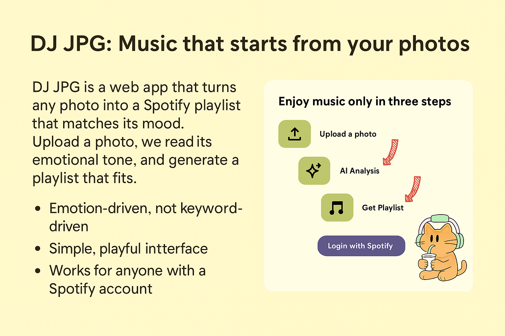

# DJ JPG: designing music discovery around a photograph

[Project overview](../README.md) · [中文介绍](../README.zh-CN.md) · [Original implementation](https://github.com/nithyaindla/DJ-JPG)

## Context

DJ JPG explores a familiar creative task: finding music that feels right for an image or a moment. A person may know the atmosphere of a road trip, a social post, or a quiet afternoon without knowing the track, artist, or search term that would express it.

The team developed a web application that accepts a photograph, uses AI to interpret its visual atmosphere, and connects the result to Spotify music discovery. The premise is a different starting point for browsing: the image comes before the playlist.

The initial problem framing comes from project proposals and team documentation. Those materials describe a product opportunity; they do not establish a measured prevalence of decision fatigue or demonstrate market demand.

## My role

I worked on **interface design, Figma prototyping, and visual design**. My contribution focused on presenting the photo-to-music experience and its interaction sequence. The project was developed with Emma Coye, Nithya Sunkara Indlamuri, and Luna Jiang.

The team source provides evidence of implementation. I do not claim the API integration or the recommendation logic as my individual development work. The supplied materials identify my UI/UX role, and my confirmed responsibilities define the scope of this portfolio account.

## Design question

**How can a photograph become an understandable starting point for music discovery?**

The interface needs to connect two different kinds of information. A user supplies a visual scene; the product returns musical suggestions. Showing only a list of songs would hide that connection. Showing only an elaborate analysis would make the result harder to reach. The experience therefore needs a clear next action at each stage and enough context to explain the recommendation direction.

## A guided journey

### 1. Establish the promise

The implementation's landing page pairs the product introduction and cat mascot with a three-step explanation: upload a photo, AI analysis, and get a playlist. A separate Spotify login action makes the required service connection visible before the user reaches the core flow.

Warm yellow and cream divide the desktop layout. Muted green step markers and a purple login button create a hierarchy between explanation and action. These choices are visible in the supplied project materials and source; their effect on conversion has not been measured.

### 2. Make the input concrete

The upload page offers drag-and-drop and file selection. The source checks that the selected file is an image, compresses it in the browser, and carries it into the next screen. Errors return an explanation rather than advancing with an unusable file.

The input is the user's own photograph, so the interface can begin with something specific instead of asking the user to name a genre or choose from abstract mood categories.

### 3. Connect the image to the music direction

The analysis view keeps the uploaded image visible while presenting a scene interpretation, mood descriptors, and suggested musical attributes. The next step leads to the playlist view.

This intermediate explanation gives the user something to compare with their own reading of the photo. A photograph can support several plausible interpretations, so these labels should be treated as suggestions. The mood scores produced by the model are not calibrated confidence scores or validated measurements of a person's feelings.

### 4. Let the user explore before saving

The playlist view combines the image and its interpretation with a track list. The implementation includes refresh and popularity controls labeled **Mainstream**, **Mixed**, and **Indie & Emerging**. It also includes loading, error, and successful playlist creation states.

The final **Add to Spotify** action comes after this review step. Users can inspect the direction before creating a playlist in their account. The popularity options express a useful distinction between familiar material and discovery, although a lower popularity score does not establish that an artist is independent or emerging.

## Visual language

The presentation uses a headphone-wearing cat, rounded forms, and warm colors to give the product a playful identity. The implementation uses yellow, cream, sage green, and purple, with Spotify green reserved for the save action in the playlist screen.

*Original concept artwork from the supplied presentation. This is a presentation graphic, not a screenshot of the current live application; its promotional copy is not independent evidence of performance or privacy guarantees.*

The [design notes](DESIGN.md) describe the hierarchy and interface states in more detail. The supplied folder does not include an accessible Figma prototype link, so this package does not present reconstructed screens as my original Figma deliverable.

## Working with implementation constraints

Team documentation identifies API integration as a major challenge, especially Spotify authentication, image request formatting, and error handling. It describes incremental development: build the upload interface, add image analysis, connect music retrieval and playlist creation, then refine the interface.

The source reflects those dependencies. Image analysis requires a configured OpenAI service; Spotify actions depend on a valid user session and permissions. The interface includes loading indicators, reauthentication messages, and retry paths to account for these conditions.

Early proposals discussed alternate AI services, a browser extension, and additional artist-discovery features. The later code uses a web application and OpenAI image analysis, and already contains popularity filtering. Those differences are documented as project evolution rather than treating every proposal as a shipped feature.

## Outcome

The team repository contains a photo upload flow, an image-analysis route, playlist-preview and creation routes, popularity filtering, and a Spotify save action. The supplied presentation also records a hosted demonstration address.

That historical address currently returns `DEPLOYMENT_NOT_FOUND`. This case study can therefore show the project materials and inspect the team source, but cannot claim that a public visitor can complete the experience today. A full authenticated session was not executed during this review.

No participant counts, task-completion rates, recommendation accuracy, or before-and-after usability results are supplied. The project report mentions testing feedback without providing a study protocol or results dataset. I describe the interface and the implementation without inventing measured impact.

## Reflection

An image can make music discovery feel personal before a user has entered a search term. The design challenge is then to make the translation visible enough to understand and flexible enough to question. Keeping the photo next to the interpretation and offering a review step before saving supports that approach.

A useful next evaluation would ask whether people recognize the intended mood, understand the popularity options, and know when a playlist has actually been saved. A further design pass should explain image transmission, avoid presenting model scores as objective judgments, and provide a reliable way to revisit the original photo or try another one. These are proposed next steps, not completed research findings.
