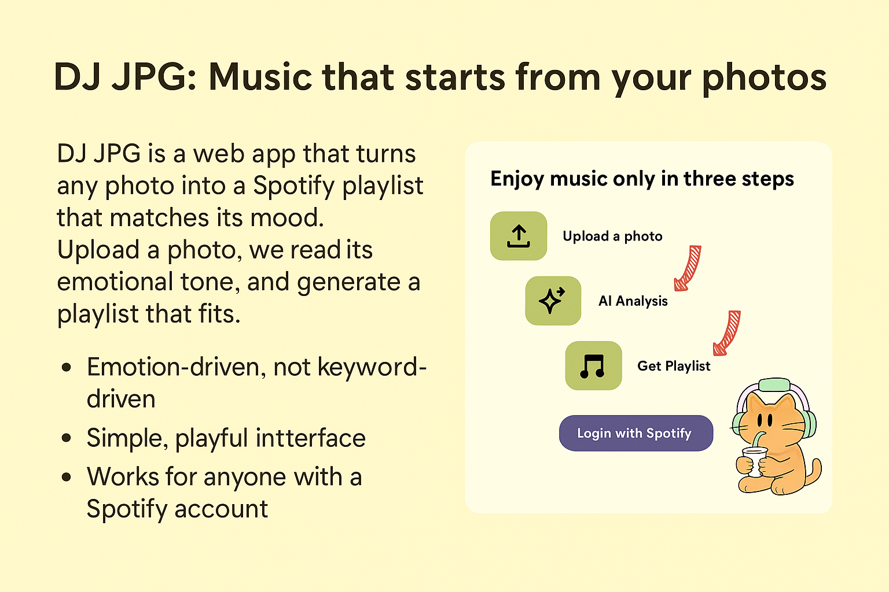

# Demo and visual assets

[Original team implementation ↗](https://github.com/nithyaindla/DJ-JPG) · [Case study](CASE_STUDY.md)

## Current viewing options

| Material | Availability |
| --- | --- |
| Team source code | Public repository available |
| Original hosted demo | Historical presentation URL currently returns `404 / DEPLOYMENT_NOT_FOUND` |
| Figma prototype | Chloe's contribution confirmed; no accessible prototype URL included in the supplied materials |
| Project visuals | Two original presentation graphics included below |

The historical address recorded in slide 7 is [djjpg-git-main-emma-coyes-projects.vercel.app](https://djjpg-git-main-emma-coyes-projects.vercel.app/). It is retained here for traceability and is not presented as a working demo button.

## Included visuals

*Project illustration, extracted from the supplied presentation.*

*Original concept graphic, not a live application screenshot. Its privacy and ease-of-use language belongs to the original presentation; implementation details and current availability are described in the technical overview.*

## Adding a working demo later

When a new deployment or the original Figma prototype is available, the primary project link can point directly to it. A short recording can then show the authentic upload, interpretation, playlist review, and save-feedback states. Until then, the original code repository is the available project destination; no simulated interaction or fabricated recording is included.
