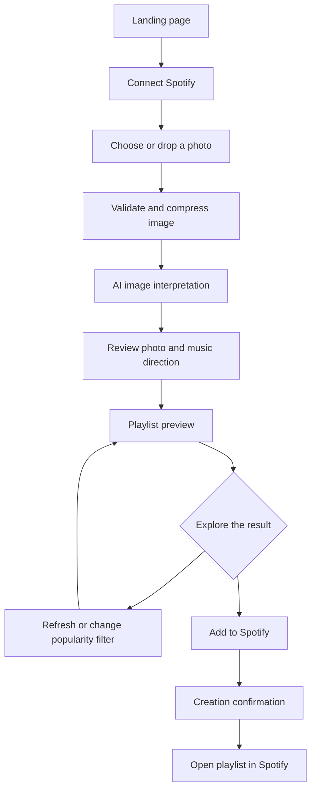

# User flow

[Overview](../README.md) · [Design notes](DESIGN.md)

The main journey below follows routes and actions in the team source. It describes intended application behavior; the full journey was not executed during the current review.

## Screen sequence

| Screen | Route | Main user action |
| --- | --- | --- |
| Introduction | `/` | Read the three-step explanation and connect Spotify |
| Photo selection | `/upload` | Drop or choose an image |
| Image interpretation | `/analyze` | Review the generated description and continue to playlist preview |
| Music exploration | `/playlist` | Review tracks, refresh, or choose a popularity option |
| Completion | Playlist success state | Open the created playlist in Spotify |

## Recovery paths

| Condition | Behavior present in the source |
| --- | --- |
| Selected file is not an image | Upload error instead of advancing |
| Image cannot fit the browser's working storage | Additional compression or an error message |
| Analysis or playlist page lacks required session data | Redirect to upload |
| AI or music service request fails | Error feedback rather than a claimed successful result |
| Spotify session or permissions are missing | Reauthentication messaging and login route |
| Playlist is loading or has no tracks | Save action disabled |
| Playlist creation succeeds | Confirmation and external Spotify link |

The analysis screen also contains an alternate playlist-creation handler. The diagram emphasizes the separate preview screen, which exposes track review and popularity controls. See the [technical overview](TECHNICAL_OVERVIEW.md) for the distinction between interface behavior and service availability.
